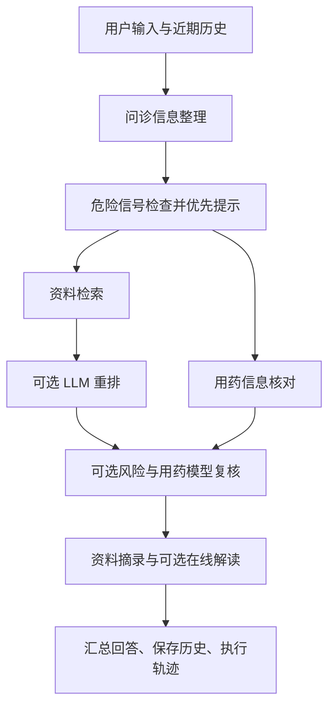

# 当前项目：Agent 提示词、上下文、编排与 RAG

以下以项目当前实际代码为准。协调器使用 Python `asyncio` 自写编排；LangChain Core 用于近期消息历史；检索路径使用原生 Transformers、Milvus、BM25 与 RRF，没有用 LangChain 封装检索。

## 1. 各个 Agent 的提示词在哪里

| 功能 | 提示词/规则的实际位置 | 说明 |
| --- | --- | --- |
| 问诊在线信息整理 | `agents/coordinator.py`，`Coordinator.run()` 中调用 `llm.structured(..., ConsultationSummary, ...)` | 系统提示词直接写在调用处，要求只提取明确描述、不诊断或给处方 |
| 风险信息模型复核 | `agents/specialists.py`，`review()` 的“风险复核 Agent”分支 | 本地风险检查由 `agents/coordinator.py` 的 `RiskAgent` 和 `agents/risk_workflow.py` 执行，不依赖提示词 |
| 用药资料模型复核 | `agents/specialists.py`，`review()` 的另一分支 | 核对 TFDA、openFDA、DDInter 等输入证据；本地药品查询在 `agents/medication_knowledge.py` |
| 来源精排/重排 | `agents/specialists.py`，`rerank()` | 只返回输入 doc_id 的完整排列，并验证没有新增或漏掉来源 |
| 在线资料解读 | `agents/coordinator.py`，`Coordinator.run()` 的 `EvidenceSummary` 调用 | 将检索证据放入输入，要求引用只来自给定资料 |
| 视觉观察 | `agents/vision.py`，`VisionAgent.run()` | 系统提示词要求中性观察；`vision_ui.py` 另提供药品包装/症状照片的任务说明 |
| 通用格式约束 | `agents/llm.py`，`LLMClient.structured()` | 在角色提示词后追加输入当数据处理、完整 JSON 对象等要求，并发送 Pydantic JSON Schema |
| 家庭协作、提醒、照护 | `agents/household_agents.py`、`agents/family.py` | 工具型 Agent，调用权限校验和 SQLite 业务函数，没有独立 LLM 提示词 |
| 协调器自身 | `agents/coordinator.py`，`Coordinator.run()` | 程序控制执行顺序与分支，没有一个让模型自主决定流程的“总协调提示词” |

本地 `ConsultationAgent`、`RiskAgent`、`MedicationAgent`、`EducationAgent` 也不是每次都调用大模型。模型增强在协调器的可选分支中执行。单独的资料解读页面当前只做原文摘录和来源整理，在线摘要在完整问诊流程中调用。

## 2. 单个 Agent 能记住上下文吗

需要按入口区分：

| 入口 | 当前上下文能力 |
| --- | --- |
| 问诊 Agent 页面、多智能体协调器页面 | 共用当前账号的对话。SQLite 保存完整记录，切换/重登后恢复；LangChain Core `InMemoryChatMessageHistory` 重建近期历史 |
| 单独的检索页面 | 每次使用本次查询；不维护自己独立的多轮问答历史 |
| 单独的风险评估页面 | 使用当前提交及传入背景；没有将所有独立风险提问自动串成聊天历史 |
| 单独的用药页面 | 可预填当前对话的过敏史和用药背景，提交后运行本次药品核对；不是独立多轮聊天 |
| 单独的资料解读页面 | 使用最近问诊证据，或本次粘贴原文；不维护独立聊天历史 |
| 视觉观察 | 使用本次图片和说明，可把观察结果交给问诊；不自动串联历次照片 |
| 家庭/提醒/照护 | 账号与成员授权下的数据库记录持久化，这属于业务状态，而不是 LLM 聊天记忆 |

核心代码：

- `conversation_ui.py::_restore()`：恢复当前账号拥有的对话，把最后六轮重建为 LangChain 历史。
- `agents/coordinator.py::ConsultationAgent.execute()`：读取最近三条用户消息，连同本次输入做本地整理和检索查询。
- `agents/coordinator.py::Coordinator.run()`：在线问诊输入使用 `history.messages[-6:]`，即最近六条消息，约三轮；结束后添加本轮用户与回答，内存最多保留十二条消息，约六轮。
- `agents/conversations.py`：SQLite 持久化，并在读写时验证不可变 owner 身份，不按昵称划分。

因此可以说“完整问诊具有按账号、按对话恢复的近期上下文”，不能说“每一个独立 Agent 都有无限长期记忆”。保存完整历史和每次把全部历史发给模型是两件不同的事。

## 3. 用什么编排，跨 Agent 如何协作

界面入口在 `consultation_run_ui.py::submit_consultation()`，通过 `asyncio.run(Coordinator(...).run(...))` 调用主流程。问诊页与协调器页共用它。

`agents/coordinator.py::Coordinator.run()` 使用：

- `await`：先完成信息整理和风险检查，后续步骤才使用这些结果。
- `asyncio.gather(..., return_exceptions=True)`：检索与用药核对并行执行，一个失败时保留另一个的结果。
- `asyncio.to_thread(...)`：把阻塞的本地工具或检索放入线程执行。
- `if` 分支：按模型配置、证据数量、重排/复核开关选择可选任务。
- `AgentResult`：统一 `agent/status/duration_ms/output/error`。
- `request_id`、`trace`、`on_event`：关联同一轮请求、保存执行轨迹，并向界面更新真实进度。

信息通过 Python 字典和函数返回值传递：问诊的 `context/query/risk_alert` 传给后续步骤，检索 `evidences` 传给解读与风险复核，用药库 `drug_evidences` 传给用药复核。最终由程序汇总结果。当前不是多个模型自行互发消息，也没有使用 LangGraph 的图状态、检查点或自主路由。

## 4. 什么是 RAG

RAG 是 **Retrieval-Augmented Generation，检索增强生成**。先检索外部资料，把相关内容连同问题交给模型，再生成有来源约束的回答。

在本项目中：

1. 用户提出资料问题。
2. `RetrievalService.search()` 从疾病库及补充资料库检索候选。
3. 可选 `rerank()` 调整已返回资料的顺序。
4. 协调器把 `doc_id/name/content` 放进 `EvidenceSummary` 模型调用的输入。
5. 对生成结果进行结构校验与来源 ID 集合校验，再展示回答与来源。

RAG 不等于重新训练模型，也不等于“把原文搜索出来”就已经完成模型生成。没有 API 时，本项目可以展示本地检索结果与摘录；在线模型生成分支会跳过。RAG 的来源检查也不等于逐句事实已被证明正确。

## 5. 粗排和精排对应什么代码

| 阶段 | 文件/函数 | 实现 |
| --- | --- | --- |
| 语义向量召回 | `agents/retrieval.py::RetrievalService.search()` | 原生 Transformers 加载 BGE，取 CLS 向量并归一化，Milvus 用 COSINE 找候选 |
| 关键词召回 | `agents/lexical.py::KeywordIndex.search()` | 中文双字切分的 BM25，补充关键词/疾病名匹配候选 |
| 粗排融合 | `agents/lexical.py::fuse()`，由 `RetrievalService.search()` 调用 | RRF 按多个排名融合，筛选并返回 top-k |
| 可选模型重排 | `agents/specialists.py::rerank()` | LLM 根据问题与资料片段返回 doc_id 排列，做来源排列校验 |
| 重排调用开关 | `agents/coordinator.py::Coordinator.run()` | 有模型、开启 `enable_rerank` 且证据数大于一时才调用 |

当前向量候选数为 `min(50, max(20, k*4))`，BM25 取二十条候选；经过阈值和 RRF，检索服务先返回 k 条，默认五条。现有 LLM 重排是在这批已返回资料上重排，不是对所有原始候选执行 Cross-Encoder 打分。

单独的检索页面直接调用 `RetrievalService.search()`，所以只执行混合召回与融合排序；要展示当前可选的 LLM 重排，应运行问诊/协调器流程，并开启模型与重排配置。
