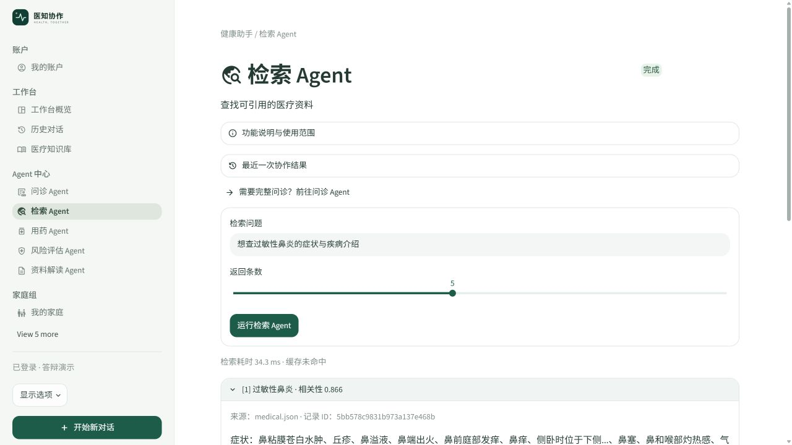
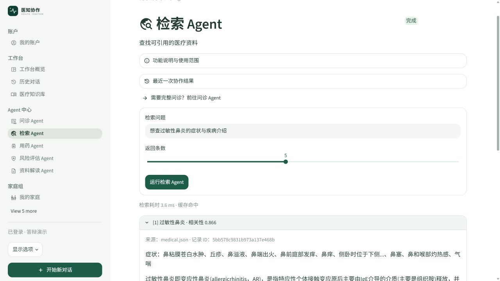

# 算法工程师任务文档

## 对应照片中的第 1 项

检索 Agent 添加 RAG，检索实现不使用 LangChain；完成 RAG 评估、缓存与异步相关工程。监控界面归第 4 项，统一采集归数据工程师。

## 负责交付

| 工作 | 当前实现与讲解要点 | 验收依据 |
| --- | --- | --- |
| 原生向量检索 | Transformers 加载本地 BGE，生成归一化 512 维向量；Milvus 主库 8,808 条疾病资料 | 检索返回来源 ID、正文及相关性 |
| 混合排序 | BM25 提供词项召回，RRF 融合；补充参考库参与检索 | 核对 `method`、候选数量与排序结果 |
| RAG 证据接口 | 检索返回 `evidences`，供资料解读/复核 Agent 使用 | 来源能回查；相关性不解释为患病概率 |
| 缓存 | 内存最多 128 项，TTL 300 秒；键含问题、K、阈值和补充库版本 | 相同问题重复检索显示缓存命中 |
| 增量索引 | 文本/PDF 读取、600 字切片/100 字重叠、持久任务队列、后台批次编码 | 任务状态可查，发布后库版本更新 |
| RAG 评估 | 固定标签 Recall@1/5/10；可选模型生成后评审忠实性、切题度、参考一致性 | 无 API 时明确跳过生成评分 |

不在本岗位重复开发：LangChain 历史、问诊核对卡规则、药品匹配、模型重试/提示词、整站页面、监控图表。新增核对卡不改变本岗位的检索职责。

## 如何实现

检索服务在页面真正发起查询时才初始化，避免切换页面加载大模型。`search()` 先检查缓存；未命中时编码问题，查询向量库，合并关键词候选与补充文档，再进行 RRF 排序。返回副本，避免调用方修改结果污染缓存。

异步有两个层次：补充资料索引由 `IndexJobs` 后台线程处理；问诊中阻塞检索通过 `asyncio.to_thread` 与用药核对并行。算法维护检索/索引任务，LLM 工程师维护外层协作调度。共享模型与索引仍受锁保护，不能宣称单机可无限并发。

RAG 的生成阶段由 LLM 工程师调用证据，本岗位提供证据契约与评估计算。检索相关性分数不是 RAG 生成质量，也不是临床诊断准确率。

## 页面截图与讲解



图 1：隔离实例实际检索“过敏性鼻炎”，返回记录 ID 和原始资料来源。展开来源可以核对原文。



图 2：第二次相同参数请求显示“缓存命中”，截图单次耗时约 3.6 ms，首轮约 34.3 ms。只是本次演示样本，不作为通用性能承诺。

## 演示顺序（约 3 分钟）

1. 登录后打开“检索 Agent”，保持默认问题并运行，展开第一条资料，说明向量、关键词与来源记录。
2. 保持参数再运行一次，对比缓存提示；修改问题再运行，解释缓存键。
3. 打开“医疗知识库”讲补充资料切片和后台任务。上传前确认资料可用于课程演示。
4. 在本机“评估与设置 → 召回评估”解释固定测试集与 Recall；运行时明确当前方法与样本数。
5. 将 `latency_ms/no_hit/cache_hit` 结果契约交给数据工程师采集，由 Web 工程师展示。

## 评估现状与剩余任务

2026-11-02 已有核查：当前混合检索在 24 条固定问句、K=10、阈值 0 下 Recall@1/5/10 分别为 33.33% / 66.67% / 70.83%。历史文件中的纯向量微调后结果为 50.00% / 83.33% / 91.67%。两种流程不能混写为同一组在线成绩。

后续本岗位负责统一方法/参数/模型版本标记，分析混排召回和排序下降的原因。生成评分需配置 API 后另测，并说明同模型自评偏差；本次没有新增付费评估。现有 RAG 质量评估不是整个家庭/视觉/临床多 Agent 的完整端到端验收。

## 交付清单

- 原生检索、切片、索引、缓存与评估源码。
- 固定测试集、模型/索引说明及按方法标记的评估报告。
- 接口字段：`evidences[]` 内的 `doc_id/name/content/source/score`，及 `latency_ms/cache_hit/method/candidates`。
- 与数据工程师约定检索失败与无命中分别记录，不把无结果等同于“没有疾病”。

## 答辩讲稿

“我负责知识检索和 RAG 的算法部分。检索链使用原生 Transformers、Milvus 和 BM25/RRF，没有使用 LangChain。结果附带原文记录编号，交给后续 Agent 做有来源的整理。我还负责缓存、补充资料索引和固定测试集评估；监控数据交给统一采集层，展示由 Web 岗位完成。当前方法与历史向量结果的分数口径不同，我会分别报告。”

## 源码位置与讲解入口

项目根目录：`C:/Users/cmy/Desktop/znt`。下列链接使用本机绝对路径；异机可按路径后半段和函数名查找。行号以本次交付为准。

| 源码位置 | 函数/区域 | 讲解内容 |
| --- | --- | --- |
| [agents/retrieval.py:53](<C:/Users/cmy/Desktop/znt/agents/retrieval.py:53>) | `RetrievalService.search` | 原生编码、向量/关键词召回、RRF、缓存 |
| [agents/lexical.py:21](<C:/Users/cmy/Desktop/znt/agents/lexical.py:21>) | `KeywordIndex.search` | BM25 召回 |
| [agents/lexical.py:32](<C:/Users/cmy/Desktop/znt/agents/lexical.py:32>) | `fuse` | RRF 融合 |
| [agents/documents.py:11](<C:/Users/cmy/Desktop/znt/agents/documents.py:11>) | `split_text` | 切片长度与重叠 |
| [agents/documents.py:51](<C:/Users/cmy/Desktop/znt/agents/documents.py:51>) | `DocumentStore.publish` | 原子发布及补充库版本 |
| [agents/documents.py:92](<C:/Users/cmy/Desktop/znt/agents/documents.py:92>) | `IndexJobs` | 后台持久索引任务 |
| [agents/quality.py:16](<C:/Users/cmy/Desktop/znt/agents/quality.py:16>) | `evaluate_quality` | 固定样本的检索与生成质量计算 |
| [medical_retrieval.py:90](<C:/Users/cmy/Desktop/znt/medical_retrieval.py:90>) | `metrics` | 历史向量训练前后评估 |
| [ui.py:9](<C:/Users/cmy/Desktop/znt/ui.py:9>) | `retrieval` | 模型惰性缓存工厂；共享文件仅负责此检索区域 |
| [test_project_completion.py:1](<C:/Users/cmy/Desktop/znt/test_project_completion.py:1>) | `页面脚本` | 索引任务和集成测试 |

## 核心源码摘录

摘录：`agents/retrieval.py:53`（完整逻辑请打开源码）。

```python
    def search(self, query, k=5, threshold=0.35):
        start = time.perf_counter()
        if not query.strip() or not 1<=k<=50 or not 0<=threshold<=1: raise ValueError('检索参数不正确')
        key = (query, k, threshold,self.documents.revision())
        with self.lock:
            if key in self.cache and time.monotonic() - self.cache[key][0] < 300:
                value = copy.deepcopy(self.cache[key][1])
                value.update(cache_hit=True, latency_ms=(time.perf_counter()-start)*1000)
                return value
            with torch.inference_mode():
                tokens = self.tokenizer(['为这个句子生成表示以用于检索相关文章：'+query], return_tensors='pt', truncation=True, max_length=64)
                vector = F.normalize(self.model(**tokens).last_hidden_state[:, 0], p=2, dim=1)[0].tolist()
```
