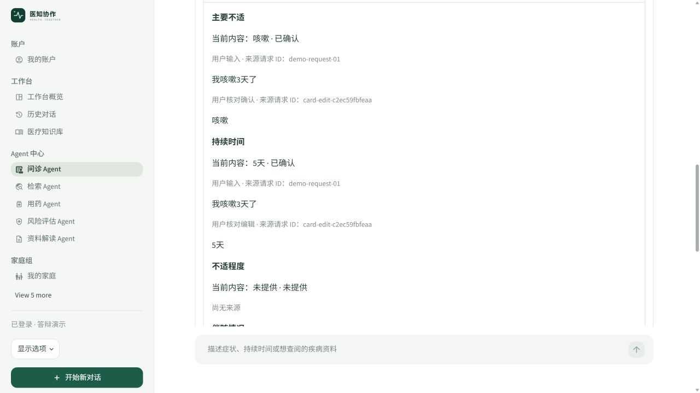
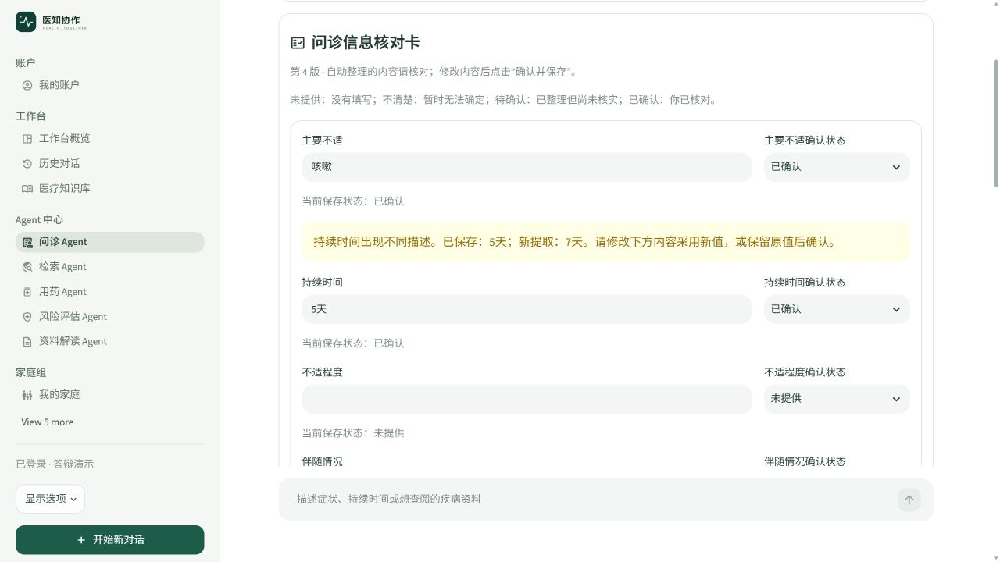
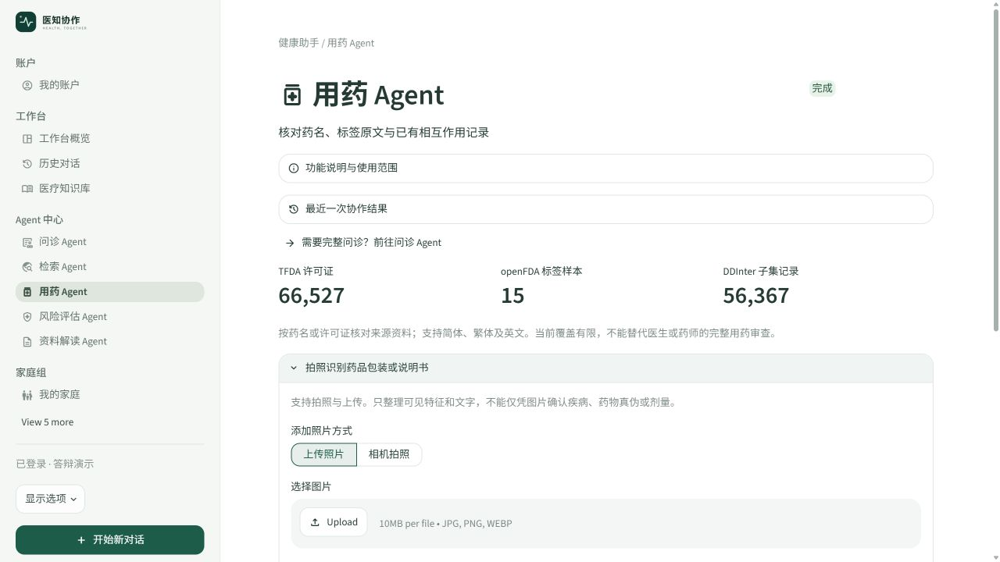

# 数据工程师任务文档

## 对应照片中的第 2 项

选择非检索 Agent，以 LangChain 管理历史；另选新功能；在各 Agent 收集监控所需数据。本项目选择 **问诊 Agent**，新增功能选定为 **问诊信息核对卡**。药品数据接入属于已交付的数据支持，不代替这项核对卡演示。

## 负责交付与边界

| 工作 | 本岗位负责 | 其他岗位负责 |
| --- | --- | --- |
| LangChain 历史 | `InMemoryChatMessageHistory` 的追加、重建和上下文契约 | Web 的历史列表、按钮与下载外观 |
| 对话持久化 | SQLite 按账号保存、恢复、重命名、删除单个对话及权限 | LLM 的调用编排 |
| 核对卡业务 | 六字段提取/合并/冲突保护、来源、版本、摘要模板 | Web 的六字段表单、来源展开和下载按钮 |
| 数据采集 | 事件表、request/session/user 绑定、Agent 状态耗时、反馈与用量字段 | Web 的统计图表与分组展示 |
| 药品数据 | TFDA/openFDA/DDInter 清洗、匹配、来源与覆盖说明 | LLM 只基于交付证据复核，Web 渲染来源卡片 |

本岗位不改检索算法，不搭建第二套 Agent 编排，不包办监控界面。核对卡是问诊的信息管理能力，不另外包装成新的 LLM Agent。

## 历史管理讲解

SQLite 保存完整对话，LangChain Core 历史对象提供近期模型上下文。打开旧对话时，以最近六轮重建历史消息，但不删除 SQLite 中的更早记录。开始新对话会创建新的对话编号；旧历史保留，核对卡也按对话独立。

账号权限检查从登录 token 取得身份，数据库操作同时验证 `conversation.id` 和 `owner`。前端隐藏按钮不能替代服务端权限检查。

## 新功能：问诊信息核对卡

六项信息：主要不适、持续时间、不适程度、伴随情况、药物过敏史、当前用药。提取复用风险模块已有的症状、否定词、时长与程度规则，补充过敏史/用药规则；没有模型或额外 API 依赖。

每个字段保存 `value/status/confirmed/sources/pending`。来源中记录请求 ID、用户原话和“输入/编辑/确认”类型。自动提取进入待确认；明确不知道显示“不清楚”；没有输入保持“未提供”。用户确认过的值，包括已确认的不清楚答案，遇到不同新描述只产生待核对项。

保存采用 SQLite `BEGIN IMMEDIATE` 事务和版本号检查。输入回执按“对话 + 请求 ID”去重；完整快照（值、状态、来源与冲突）没有变化时不写新版本，新请求可因新增来源形成版本；旧页面提交不同修改会被拒绝并要求核对最新卡。删除一个对话时，也删除它的核对卡版本和输入回执。

摘要由固定 Markdown 模板生成，只列已有信息、待补充项与来源，不调用模型、不生成诊断或用药建议。已经确认的过敏/用药信息可补充到空缺的问诊上下文；不会覆盖用户另行填写的个人情况。



图 1：持续时间的当前值为“5天”，仍保留最初“我咳嗽3天了”的请求与原话；人工修改另有编辑请求 ID。旧值没有被抹去。



图 2：补充“7天”后，已保存的“5天”仍保留，界面提示用户核对；未经确认不会自动改写。

## 各 Agent 采集什么、在哪里显示

| 生产者 | 采集字段/事件 | Web 展示入口 |
| --- | --- | --- |
| 主协作链、独立 Agent 页面 | `agent/status/latency_ms/error/request/session/user_id` | 运行监控 → Agent 执行记录、失败事件 |
| 检索链 | `retrieval` 的耗时、`no_hit/cache_hit` | 检索平均/P99/无命中/缓存指标 |
| LLM 客户端 | `llm` 的模型、主备、尝试次数、输入输出 token、成本 | LLM 按 request/用户/日期分组 |
| 视觉、家庭/提醒/照护 | Agent 操作名、状态、耗时；失败分类 | Agent 表和失败表 |
| 问诊反馈 | `feedback.positive`，允许取消或更新 | 好评/差评/反馈覆盖率 |
| 核对卡确认保存 | `agent=问诊信息核对`、`version/status/latency_ms` | Agent 执行记录；只有发生新版本才采集 |

字段原话和照片不写入监控事件。核对卡原话在账号私有对话数据库内保存，不能把两者混同。统一采集机制与监控图表分别由数据和 Web 负责。

## 药品数据补充说明



图 3：实际界面显示 66,527 个 TFDA 许可证、15 条 openFDA 标签样本、56,367 条 DDInter 子集记录。数量分别代表不同类型的数据，不可相加称为完整药品库。

数据模块支持繁简转换、许可证/名称/成分识别、歧义提示和重复成分信息。TFDA 地区资料不等于用户手中具体药品；openFDA 这里只是 15 条样本；DDInter 未覆盖或 Unknown 不代表安全。DDInter 的非商业与署名共享许可约束见项目 `MEDICATION_DATA.md`，原始数据不随本套文档分发。

## 演示和验收

1. 在问诊输入“我咳嗽3天了”，查看咳嗽、3天及待确认状态。
2. 补充“无已知药物过敏，现在没吃药”，核对两项新增信息。
3. 把3天改成5天，确认保存，展开来源与版本，下载摘要检查当前值。
4. 再补充不同时间，证明确认值保护；重复保存证明版本去重。
5. 新建对话，再切回旧对话；退出后重登恢复；其他账号不得读取旧卡。
6. 向 Web 工程师交付采集字段，现场指出“运行监控 → Agent 执行记录”。

专项测试命令：`.venv\Scripts\python.exe -m unittest test_consultation_card -v`，本次 9 项通过。更完整的输入输出与恢复验收见第 05 份文档。

待完善的统一采集事项：预算预检/本地限流仍有部分入口不记失败事件，失败且可能收费的尝试未完整计价。本岗位与 LLM 岗位按事件契约修补，不能把现有成功调用金额当作完整账单。

## 答辩讲稿

“我选择问诊 Agent 完成 LangChain 历史管理，完整记录按账号放入 SQLite，模型上下文按需重建。额外功能是信息核对卡：自动整理六项信息，用户确认后受到保护，所有修改有来源与版本，摘要使用固定模板。各 Agent 的状态和耗时由我统一采集，监控面板由 Web 岗位实现；我不重复开发检索算法和模型调度。”

## 源码位置与讲解入口

项目根目录：`C:/Users/cmy/Desktop/znt`。下列链接使用本机绝对路径；异机可按路径后半段和函数名查找。行号以本次交付为准。

| 源码位置 | 函数/区域 | 讲解内容 |
| --- | --- | --- |
| [conversation_ui.py:30](<C:/Users/cmy/Desktop/znt/conversation_ui.py:30>) | `_restore` | SQLite 完整历史到 LangChain 最近消息的重建 |
| [conversation_ui.py:56](<C:/Users/cmy/Desktop/znt/conversation_ui.py:56>) | `new_conversation` | 新对话创建，旧历史保留 |
| [agents/conversations.py:25](<C:/Users/cmy/Desktop/znt/agents/conversations.py:25>) | `_owner` | 现有账号权限入口 |
| [agents/conversations.py:29](<C:/Users/cmy/Desktop/znt/agents/conversations.py:29>) | `_owned` | 对话所有权检查 |
| [agents/conversations.py:126](<C:/Users/cmy/Desktop/znt/agents/conversations.py:126>) | `ingest_card` | 输入回执与原子合并 |
| [agents/conversations.py:143](<C:/Users/cmy/Desktop/znt/agents/conversations.py:143>) | `save_card` | 版本检查、去重和确认保存 |
| [agents/conversations.py:157](<C:/Users/cmy/Desktop/znt/agents/conversations.py:157>) | `card_versions` | 有权限的版本读取 |
| [agents/consultation_card.py:26](<C:/Users/cmy/Desktop/znt/agents/consultation_card.py:26>) | `extract` | 复用本地规则的六字段提取 |
| [agents/consultation_card.py:79](<C:/Users/cmy/Desktop/znt/agents/consultation_card.py:79>) | `merge` | 已确认值的冲突保护 |
| [agents/consultation_card.py:95](<C:/Users/cmy/Desktop/znt/agents/consultation_card.py:95>) | `confirm` | 人工编辑来源与状态转换 |
| [agents/consultation_card.py:136](<C:/Users/cmy/Desktop/znt/agents/consultation_card.py:136>) | `summary` | 固定模板 Markdown 摘要 |
| [agents/telemetry.py:25](<C:/Users/cmy/Desktop/znt/agents/telemetry.py:25>) | `record` | 统一事件存储及身份绑定 |
| [agents/telemetry.py:35](<C:/Users/cmy/Desktop/znt/agents/telemetry.py:35>) | `feedback_stats` | 反馈取消/更新与有效反馈口径 |
| [agents/drug_data.py:47](<C:/Users/cmy/Desktop/znt/agents/drug_data.py:47>) | `build` | 三来源离线药品库构建 |
| [agents/medication_knowledge.py:57](<C:/Users/cmy/Desktop/znt/agents/medication_knowledge.py:57>) | `DrugKnowledge.check` | 药名匹配、重复成分、已覆盖相互作用 |
| [test_consultation_card.py:23](<C:/Users/cmy/Desktop/znt/test_consultation_card.py:23>) | `CardTests` | 9 项权限、规则、版本与 UI 测试 |

## 核心源码摘录

摘录：`agents/consultation_card.py:79`（完整逻辑请打开源码）。

```python
def merge(card, extracted):
    """Protect confirmed values, including a user-confirmed unknown answer."""
    result = copy.deepcopy(card)
    for key, candidate in extracted.items():
        field = result[key]
        if field['value'] == candidate['value']:
            for source in candidate['sources']:
                if source not in field['sources']: field['sources'].append(source)
            continue
        if field['confirmed']:
            field['pending'] = copy.deepcopy(candidate)
        else:
            result[key] = dict(candidate, confirmed=False, pending=None)
    return result
```
