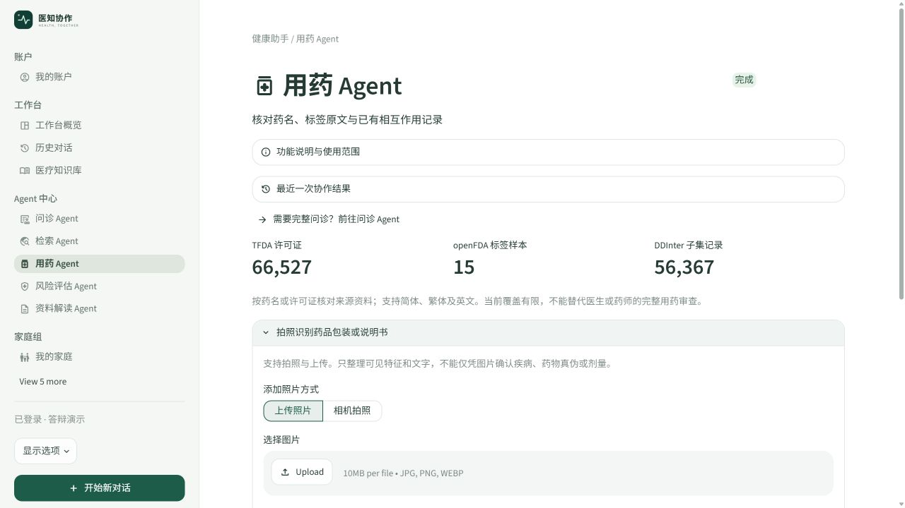
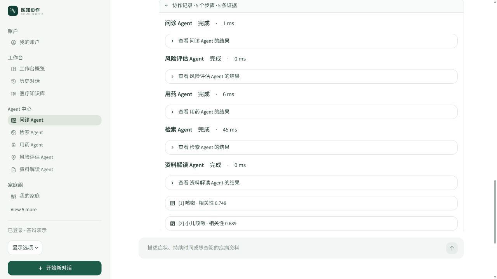

# LLM 工程师任务文档

## 对应照片中的第 3 项

新增一个或多个 Agent，使用 LangGraph 或自行编写代码编排。本项目采用自写 `asyncio` 编排，符合照片允许的第二种方式，无需为了形式再迁移 LangGraph。

## 负责交付

| 工作 | 实际实现 | 与其他岗位的边界 |
| --- | --- | --- |
| 新增视觉观察 Agent | 支持图片输入、可见文字/特征整理、结构化校验 | Web 把入口嵌入问诊和用药；数据负责事件字段 |
| 新增复核 Agent | 风险复核、用药复核，输出带来源与局限 | 药品证据由数据工程师提供，检索证据由算法提供 |
| 新增重排 Agent | 模型仅返回输入来源 ID 的完整排列 | 原生 BM25/RRF 基础排序由算法工程师负责 |
| 多 Agent 编排 | 问诊整理→危险信号→检索/用药并行→可选复核与资料解读→汇总 | 不重复实现检索、数据库历史或 Web 页面 |
| 模型 API 执行 | 主备接口、超时重试、结构化输出、SSE 接收、预算执行 | 数据工程师约定用量/失败事件；Web 展示配置和错误 |

核对卡属于数据管理功能，不新增一套提取模型。本岗位只维护 `Coordinator.run(..., request_id=None)` 的兼容参数，让页面提取来源和整轮协作使用同一请求编号；已有调用方不传时仍可自动生成。

## 编排讲解

协调器先运行问诊信息整理，再做本地危险信号检查。危险提醒通过进度回调先送到页面；之后仍继续提供相关资料与用药信息核对，不能让后续输出降低提醒优先级。

阻塞检索进入 `asyncio.to_thread`，与用药核对 `asyncio.gather(..., return_exceptions=True)` 并行。单一路径失败会保留其他成功结果。每个步骤输出 `AgentResult`，包含角色、状态、耗时、结果和错误；事件内容交给数据岗位的统一采集接口。

在线模型未配置时，基础本地链仍能工作。配置后，重排与复核按开关运行。用药复核只接受药品相关证据，不使用疾病百科推断药物相互作用；返回来源必须属于实际输入集合。

## 新 Agent 的输入和限制

视觉观察仅整理图中可见内容，不凭图片诊断或判断药品真伪/剂量。上传格式限 JPEG/PNG/WebP，大小不超过 10 MB、像素不超过 2,000 万；转正、去除附带元数据、缩到 512 像素后发送给已配置服务。用户必须选择同意发送，日志不保存图片正文。

风险复核不生成未经验证的临床评分；用药复核不得生成处方、停药或剂量建议。`Ranking` 要求完整且不重复的来源 ID 排列；`SpecialistReview` 的引用 ID 也必须来自证据。Pydantic 校验失败保留本地结果，不能靠填空掩盖不完整模型响应。

家庭协作、定时关怀和亲属照护也有工具型 Agent 包装及权限接口，但它们执行的是确定性业务操作，不应宣称全部依赖 LLM 自主推理。家庭入口单独放在家庭组中。

## 真实页面截图



图 1：照片上传与相机入口已合并到用药页面。此截图没有启用视觉 API，仅证明实际入口与交互布局；不能拿它当作真实模型识图准确率的验收。



图 2：本次真实问诊运行完成了五个本地步骤，包含检索资料。没有配置 API，因此这张图不包含在线视觉/复核步骤；在线契约由离线测试验证，真实供应商响应需要配置后联调。

## 演示顺序（约 3 分钟）

1. 打开用药页面的拍照入口，说明视觉模型与文本模型可以独立配置。
2. 用一个普通症状完成问诊，展开协作轨迹，讲清串行、并行、失败隔离和来源回查。
3. 通过危险信号测试用例说明提醒先于慢检索展示，检索和用药仍继续。
4. 在源码中展示 `asyncio.gather`、提示词和来源校验；区分程序保证与模型判断。
5. 说明核对卡与同轮协作用同一 `request_id`，但核对卡本身不调用模型。

真实图片联调需要用户自行填写兼容视觉 API。不要把文本模型名称直接当作支持识图的证明，不在答辩截图中展示密钥。

## 测试与后续事项

执行：`.venv\Scripts\python.exe -m unittest test_llm_engineering test_project_completion test_risk_results test_vision_monitor`。

这些测试覆盖模拟 HTTP 的结构化输出、超时/限流重试、主备、SSE、预算、引用校验、危险信号优先和失败保留，属于离线执行契约。它们不代表已经验证所有实际供应商模型效果。

后续与数据岗位共同完善客户端预检拒绝的统一失败埋点：本岗位控制调用前异常流程，数据岗位定义分类与去重；Web 岗位只消费事件，不在页面补造失败。

## 答辩讲稿

“我负责增加视觉观察、来源重排和风险/用药复核，并用 asyncio 自写协作编排。危险信号先展示，资料检索与用药核对继续并行运行。模型输出有严格结构和引用校验，失败时保留本地结果。历史、检索和药品数据库由对应岗位提供，我只负责它们之间的执行调度和模型调用。”

## 源码位置与讲解入口

协调器现有独立展示入口：登录后「工作台 → 多智能体协调器」，地址 `/coordinator`。LLM 岗位负责 `agents/coordinator.py` 的调度及 `on_event` 事件；页面、汇总指标和结果展开归 Web 岗位。问诊页与协调器复用同一调度器，不是两个相互独立的问诊流程。整轮 `duration_ms` 使用真实墙钟时间，不能把并行步骤耗时相加。

项目根目录：`C:/Users/cmy/Desktop/znt`。下列链接使用本机绝对路径；异机可按路径后半段和函数名查找。行号以本次交付为准。

| 源码位置 | 函数/区域 | 讲解内容 |
| --- | --- | --- |
| [agents/vision.py:39](<C:/Users/cmy/Desktop/znt/agents/vision.py:39>) | `VisionAgent.run` | 新增视觉观察 Agent |
| [agents/vision.py:21](<C:/Users/cmy/Desktop/znt/agents/vision.py:21>) | `prepare_image` | 安全读取及发送前图像处理 |
| [agents/specialists.py:19](<C:/Users/cmy/Desktop/znt/agents/specialists.py:19>) | `rerank` | 新增来源重排及排列校验 |
| [agents/specialists.py:26](<C:/Users/cmy/Desktop/znt/agents/specialists.py:26>) | `review` | 风险/用药复核提示词及引用校验 |
| [agents/coordinator.py:78](<C:/Users/cmy/Desktop/znt/agents/coordinator.py:78>) | `Coordinator.run` | 自写多 Agent 调度；接收同一来源 request_id |
| [agents/coordinator.py:13](<C:/Users/cmy/Desktop/znt/agents/coordinator.py:13>) | `AgentResult` | 编排结果契约 |
| [agents/llm.py:76](<C:/Users/cmy/Desktop/znt/agents/llm.py:76>) | `LLMClient.structured` | 模型协议、重试、主备、SSE、预算控制 |
| [agents/llm.py:22](<C:/Users/cmy/Desktop/znt/agents/llm.py:22>) | `validate_output` | 结构化输出校验 |
| [agents/household_agents.py:10](<C:/Users/cmy/Desktop/znt/agents/household_agents.py:10>) | `HouseholdAgent.run` | 工具型 Agent 包装，业务权限由 family 模块实施 |
| [test_llm_engineering.py:1](<C:/Users/cmy/Desktop/znt/test_llm_engineering.py:1>) | `页面脚本` | 模拟 API 契约与编排验证 |
| [test_risk_results.py:1](<C:/Users/cmy/Desktop/znt/test_risk_results.py:1>) | `页面脚本` | 危险信号、资料继续加载与失败隔离测试 |

## 核心源码摘录

摘录：`agents/specialists.py:19`（完整逻辑请打开源码）。

```python
async def rerank(client,question,evidence,session,request):
    value=await client.structured('按与问题的相关性重排给定资料，只返回全部输入 doc_id 的排列，不新增或遗漏。',dict(question=question,evidence=[dict(doc_id=x['doc_id'],name=x['name'],content=x['content'][:400]) for x in evidence]),Ranking,session,request,'检索重排 Agent')
    ids=value.ordered_source_ids; allowed={x['doc_id'] for x in evidence}
    if len(ids)!=len(evidence) or set(ids)!=allowed: raise LLMError('invalid_citation')
    by_id={x['doc_id']:x for x in evidence}
    return [by_id[key] for key in ids]

```
