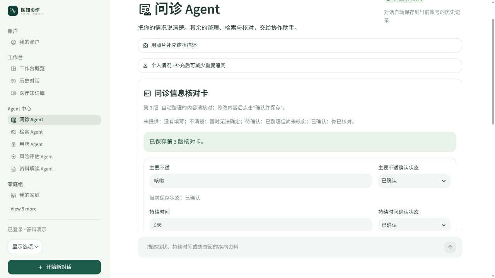
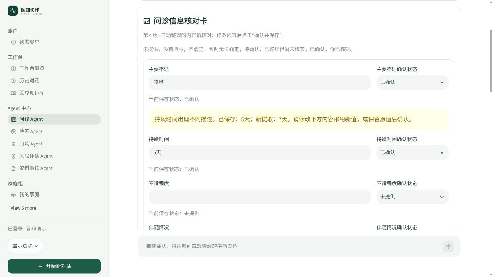

# Web 工程师任务文档

## 对应照片中的第 4 项

负责整个项目 Web 页面和独立 Agent 监控面板，必须呈现检索性能、索引规模、LLM 成本分组、用户反馈和失败模式。

## 页面交付范围

| 区域 | 页面行为 | 不在页面重复开发的逻辑 |
| --- | --- | --- |
| 账户与导航 | 注册/登录门禁、登录后导航、退出、页面切换 | 数据岗位的身份与持久化权限接口 |
| 问诊 | 文字对话、照片入口、即时状态、证据和可读结果 | LLM 调度、算法检索、业务提取规则 |
| 历史 | 最近对话、搜索、继续、重命名、单个删除、导出 | SQLite 保存、LangChain 重建由数据岗位维护 |
| 用药/检索/风险/资料解读 | 独立表单、来源卡片、失败提示、可读结果 | 底层 Agent 的判断与资料匹配 |
| 家庭组 | 家庭列表、成员/指定留言、照护、提醒时间窗口 | 服务端成员授权、定时逻辑和业务数据 |
| 项目管理 | 评估结果渲染、接口设置、运行监控 | 评估算法与事件生产者分别由算法、数据提供 |

视觉功能嵌入问诊/用药；家庭协作、亲属照护和关怀提醒归“家庭组”，不放在 Agent 中心。生产界面以中文说明和来源卡片呈现，JSON 仅保留在可选开发调试中。

## 本次新增：核对卡交互

表单展示六个可编辑字段及四类状态。点击确认保存后，已填的待确认字段变为已确认；用户也可选择未提供或不清楚。不同新描述用警示条显示，同时保留原确认值。来源与历史版本放在独立展开区，摘要使用数据岗位提供的固定模板。

控件键包含对话 ID 和版本号；新版本会载入新值，切换对话不会串卡。表单批量提交，编辑中不会逐键运行问诊检索或调用模型。服务端版本冲突后重新载入最新卡，并提示重新核对。



图 1：真实页面保存“5天”并显示已确认。此图说明 Web 的编辑与状态展示；来源合并和版本算法由数据岗位维护。



图 2：警示条同时列出5天与新提取的7天，表单仍保持5天。用户可以修改后保存，也可保留旧值后确认。

## 监控指标逐项对应

日常本机入口：`http://localhost:8502/monitor`，登录后选择“项目管理 → 运行监控”。最近最多 5,000 条事件，可选择会话范围。公网普通用户当前看不到此管理页，不能用本机截图证明公网管理端完成。

| 照片指标 | 展示位置 | 计算/展示口径 |
| --- | --- | --- |
| 平均 latency | 顶部“检索平均耗时” | 所选范围 `retrieval.latency_ms` 均值 |
| P99 latency | 顶部“检索 P99” | `numpy.percentile(lat,99)`；小样本只是窗口统计 |
| 无 hit 比例 | 顶部“无命中率” | 检索事件 `no_hit` 均值；不是标注 Recall |
| chunks 总数 | “索引规模与更新时间”展开区 | 主库记录/向量数、补充库切片数分别列出 |
| 最近索引时间 | 同一索引展开区 | manifest 的 `indexed_at` 和补充库更新时间；缺失则显示未记录 |
| LLM 按 query | “LLM 用量分组 → request” | 一轮 query 的请求编号，不显示症状正文 |
| LLM 按用户 | “LLM 用量分组 → user_id” | 用户标识；从统一身份绑定取得 |
| LLM 按时间 | “LLM 用量分组 → 日期” | 北京时间日期分组 |
| 用户赞/踩率 | “好评率/差评率/反馈覆盖率” | 赞踩分母是有效反馈；覆盖率分母是请求数 |
| 失败模式 | “失败事件”分类表与明细 | 超时、供应商/本地限流、解析失败、预算溢出等真实事件 |
| 各 Agent 状态与耗时 | “Agent 执行记录”表 | 统一事件中的角色、请求、状态、耗时与错误 |
| 核对卡保存 | Agent 表的“问诊信息核对”记录 | 新版本号及耗时；不显示字段原话 |

没有在线调用时，LLM 分组表不出现；没有反馈时显示暂无反馈。成本字段未填单价或无真实用量时显示未计价，不能用假0元冒充账单。单次 query 可包含多个模型调用，不能把调用数当作问诊轮数。

## 演示与数据交接

1. 未登录打开问诊入口，验证登录门禁；正常登录后展示导航分组。
2. 演示核对卡保存、来源、Markdown 下载，以及历史切换恢复。
3. 运行相同检索两次；到监控展示平均/P99、无命中与缓存情况。
4. 展开索引区，解释主库和补充库；没有元数据时如实说明。
5. 展示已配置 API 的真实用量分组；未配置时说明空态并打开对应源码，不能补造在线记录。
6. 说明“数据岗位负责事件生产，我负责筛选、计算和可读展示”。

本套截图未包含当前监控面板的费用/失败记录：演示实例未启用 API，也未刻意制造失败。指标入口和计算位置均在本文件及源码定位表中列明。

## 验收与剩余事项

本次页面切换性能脚本通过，10 页各三轮中，空白问诊页面约118～200 ms（AppTest 脚本耗时，不含真实网络与检索）。切换页不应初始化推理模型。

后续仍需：受权限保护的公网管理员监控/评估入口；成本实际配置及完整口径；评估页面标明历史/当前算法。成本采集缺口由数据/LLM 修补后再呈现，不在 Web 层填充模拟指标。

测试入口：`test_consultation_card.py` 的页面保存/切换/重登测试；`test_history_message_pages.py` 的历史与指定留言流程；`test_navigation_performance.py` 的页面切换检查。

## 答辩讲稿

“我负责用户实际操作的 Web 页面和监控。核对卡使用原生表单，能编辑、看来源版本并下载摘要。监控把其他岗位采集的真实事件统计成检索耗时、P99、无命中、成本分组和反馈指标。页面只负责清楚呈现，不再实现一遍提取、数据库或模型编排逻辑；本机管理页与公网普通用户页也作了区分。”

## 源码位置与讲解入口

项目根目录：`C:/Users/cmy/Desktop/znt`。下列链接使用本机绝对路径；异机可按路径后半段和函数名查找。行号以本次交付为准。

| 源码位置 | 函数/区域 | 讲解内容 |
| --- | --- | --- |
| [app.py:1](<C:/Users/cmy/Desktop/znt/app.py:1>) | `页面脚本` | 登录门禁、导航分组与本机/公网页面注册 |
| [app_pages/agent_consultation.py:1](<C:/Users/cmy/Desktop/znt/app_pages/agent_consultation.py:1>) | `页面脚本` | 问诊 UI 接入核对卡及协作进度 |
| [consultation_card_ui.py:9](<C:/Users/cmy/Desktop/znt/consultation_card_ui.py:9>) | `card_panel` | 表单、状态、来源/版本展开和下载 |
| [app_pages/conversations.py:1](<C:/Users/cmy/Desktop/znt/app_pages/conversations.py:1>) | `页面脚本` | 历史管理页面 |
| [app_pages/monitor.py:1](<C:/Users/cmy/Desktop/znt/app_pages/monitor.py:1>) | `页面脚本` | 五类指标、会话筛选、成本分组和执行明细 |
| [app_pages/evaluation.py:1](<C:/Users/cmy/Desktop/znt/app_pages/evaluation.py:1>) | `页面脚本` | 评估展示与配置表单 |
| [evaluation_ui.py:44](<C:/Users/cmy/Desktop/znt/evaluation_ui.py:44>) | `render_quality_report` | 可读评估报告和导出 |
| [vision_ui.py:7](<C:/Users/cmy/Desktop/znt/vision_ui.py:7>) | `vision_panel` | 嵌入式视觉输入 UI |
| [medication_ui.py:1](<C:/Users/cmy/Desktop/znt/medication_ui.py:1>) | `页面脚本` | 药品来源可读展示 |
| [result_ui.py:11](<C:/Users/cmy/Desktop/znt/result_ui.py:11>) | `render_output` | 各 Agent 输出中文渲染 |
| [test_navigation_performance.py:1](<C:/Users/cmy/Desktop/znt/test_navigation_performance.py:1>) | `页面脚本` | 页面切换及惰性加载检查 |

## 核心源码摘录

### 独立协调器入口（补充）

登录后选择「工作台 → 多智能体协调器」（`/coordinator`）。输入描述并点击“运行协作流程”，页面先显示实时执行时间轴，完成后显示整轮耗时、完成步骤、危险信号检查、协调提醒、各 Agent 的可读输出及参考来源。危险提示在检索资源加载前展示；检索失败会保留风险与用药核对结果。

| 源码 | Web 职责 |
| --- | --- |
| [app_pages/coordinator.py](<C:/Users/cmy/Desktop/znt/app_pages/coordinator.py>) | 协调器输入、当前对话的轮次选择、页面入口 |
| [consultation_run_ui.py](<C:/Users/cmy/Desktop/znt/consultation_run_ui.py>) | 两个页面共用的提交入口、进度渲染和结果保存接入 |
| [coordinator_ui.py](<C:/Users/cmy/Desktop/znt/coordinator_ui.py>) | 真实结果的总览卡、时间轴、各 Agent 输出展开 |
| [execution_timeline.py](<C:/Users/cmy/Desktop/znt/execution_timeline.py>) | 事件状态合并和 Streamlit 原生纵向时间轴 |
| [test_coordinator_page.py](<C:/Users/cmy/Desktop/znt/test_coordinator_page.py>) | 页面共享历史、重放、账号隔离、新对话和危险提示顺序验证 |

与问诊 Agent 共用账号私有 SQLite 对话和核对卡。切换页面或轮次只读取已有轨迹，不重复调用模型。旧记录未保存整轮耗时时显示“耗时未记录”；没有危险关键词时显示“尚不能确定”，不能展示伪造的临床风险分数。后端编排控制流由 LLM 岗位负责，核对卡业务及存储由数据岗位负责。

摘录：`consultation_card_ui.py:9`（完整逻辑请打开源码）。

```python
def card_panel():
    token = st.session_state.personal_token
    conversation = st.session_state.conversation_id
    # Migrate existing turns lazily. Receipts make reruns idempotent, including conflicts.
    for turn in st.session_state.turns:
        original = turn.get('card_original', turn['question'].split('\n图片观察（AI 描述，未经核实）：')[0])
        if not original.strip(): continue
        store.ingest_card(token, conversation, turn['request'], original)
    card = store.load_card(token, conversation)
    prefix = f'check_card_{conversation}_{card["version"]}'
    with st.container(border=True):
```
