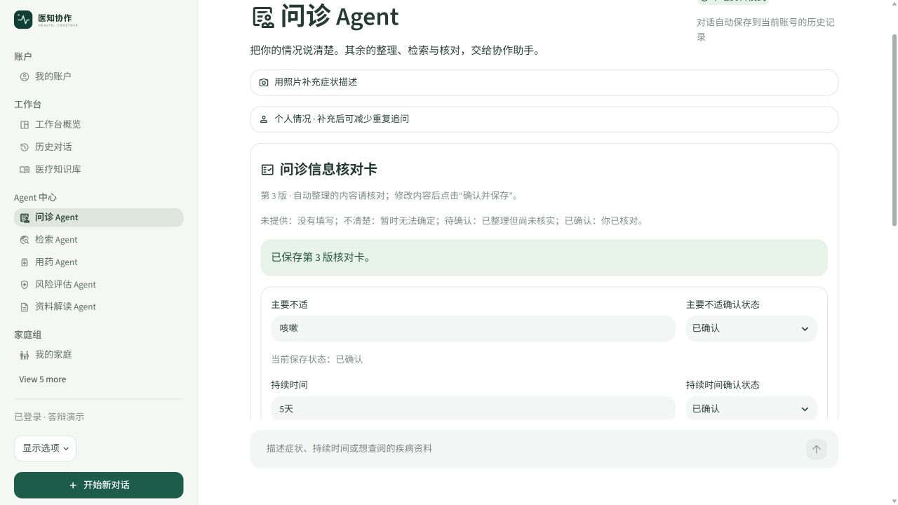
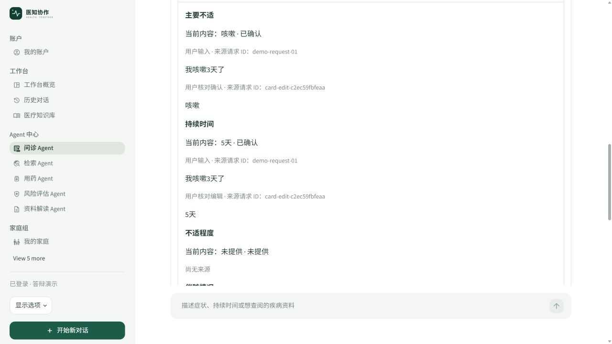
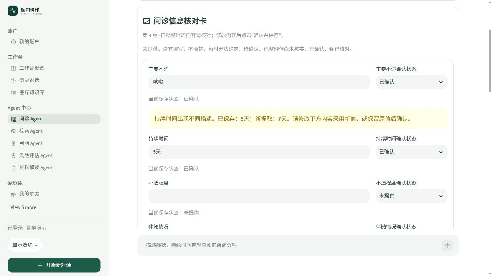

# 问诊信息核对卡：实现与验收

交付日期：2026-11-02（北京时间）。本功能已经修改实际项目源码，基础提取、合并、保存和摘要生成不依赖新模型或额外 API。

## 功能与职责

数据工程师负责业务模块和 SQLite 存储：`agents/consultation_card.py`、`agents/conversations.py`。Web 工程师负责 `consultation_card_ui.py` 与问诊页面接入。LLM 工程师只为协调器增加兼容的 `request_id` 参数。算法工程师无需修改检索来实现这张卡。

保留现有 LangChain 历史、检索、危险信号、用药检查及监控。核对卡是同一问诊页面内的功能，没有另加导航或新的模型依赖。

## 六项信息与状态

| 字段 | 示例 | 来源 |
| --- | --- | --- |
| 主要不适 | 咳嗽 | 复用已有症状及否定词规则；可手工修正 |
| 持续时间 | 3天 | 复用已有中文/数字时长规则 |
| 不适程度 | 轻微、严重 | 复用已有程度规则 |
| 伴随情况 | 无伴随症状、伴有发热 | 本地规则及明确标签 |
| 药物过敏史 | 无已知药物过敏、不清楚 | 明确过敏表述或手工填写 |
| 当前用药 | 目前未用药、用户给出的药名 | 明确用药表述或手工填写 |

未提供表示缺失，不清楚表示用户明确不知道，待确认表示已整理但未核实，已确认表示已点击确认保存。用户填写后可以修正，系统不会把未提供当作否定答案。

## 完整演示

1. 启动现有项目：在项目目录执行 `powershell -ExecutionPolicy Bypass -File .\start_app.ps1 -NoBrowser`，打开 `http://localhost:8502/agent_consultation` 并登录。
2. 点击“开始新对话”，输入“我咳嗽3天了”。卡片应显示“咳嗽、3天”，状态待确认，其他字段保持未提供。
3. 补充“无已知药物过敏，现在没吃药”，两个对应字段更新；这两句仍分别有自己的来源请求 ID。
4. 在卡片把3天改为5天，点击“确认并保存”。待确认的已填字段变成已确认，新增保存版本。
5. 展开“查看字段来源与修改版本”，持续时间应同时保留原始输入及人工修改来源。下载 Markdown，已有信息使用5天，待补充区列出程度和伴随情况。
6. 再输入“我咳嗽7天了”，出现冲突提示，原确认值仍是5天。选择改成7天并保存，或保留5天后确认。
7. 重复保存、刷新、切换页面，内容没有变化时版本数不增加。
8. 新建对话应得到独立空卡；从历史回到旧对话应恢复旧卡。重新登录同一服务后仍能恢复；另一个账号不得读取该对话卡。

完整问诊仍会按原配置执行检索和可选模型调用。核对卡先保存用户原话，因此即使后续协作失败，它也能保留本次信息；下载摘要不触发模型。







## 存储与一致性

沿用运行目录下的 `conversations.sqlite`。首次启动自动增加两张表，不改写既有对话记录：

| 表 | 键 | 内容 |
| --- | --- | --- |
| `consultation_card_versions` | conversation + version | 创建时间、原因、六项完整快照 |
| `consultation_card_inputs` | conversation + request | 原话与输入回执，用于去重和防止重跑旧提取 |

`_owner` 验证登录 token，`_owned` 检查对话 owner。读取、输入合并、确认保存和版本列表都经过权限检查。新对话自然使用新主键；对话删除时同步清理相关表。

已确认字段遇到不同内容写入 `pending`，不自动覆盖。显式修改后，来源列表保留原输入和编辑来源；旧快照可从版本查看。用户选择保留原值也会关闭冲突，处理前的候选仍保存在旧版本中。

保存时 `BEGIN IMMEDIATE` 串行化同库写入；`expected_version` 防止其他页面的旧表单覆盖新卡；已经成功的相同内容重试直接返回现有版本。相同请求 ID 携带不同原话会被拒绝。

图片观察为未经核实的 AI 内容，不作为新的用户原话提取到卡片。新增输入先保存原始文字，之后才向既有协作链附加图片观察内容。历史对话首次打开时可按输入回执幂等补建核对卡。

## 测试结果

专项复验命令：`.venv\Scripts\python.exe -m unittest test_consultation_card -v`。本次完整回归实际执行了其中的9项，全部通过，覆盖：

- 用户指定示例、5天摘要及原话/编辑来源。
- 已确认值冲突保护、用户采用新值。
- 重复输入、重复保存、页面重跑和旧请求回放不重复生成版本。
- 新旧对话隔离、重新登录恢复、其他账号及撤销 token 拒绝访问。
- 未知状态、否定词、伴随症状和明确字段标签。
- 旧表单版本冲突、删除对话同步清理。
- 实际 Streamlit 表单修改、连续保存、刷新/对话切换恢复。
- 完整问诊页面共用请求编号、隔离 AI 图片描述、协作失败仍保留核对信息。
- 完整问诊页面共用请求编号、隔离 AI 图片描述、协作失败仍保留核对信息。
- 完整问诊页面共用请求编号、隔离 AI 图片描述、协作失败仍保留核对信息。
- 已确认不清楚的保护，以及过敏/用药确认信息补充到空缺问诊上下文。

合并运行核对卡、对话、LLM、编排、风险、视觉/监控、用药测试，共73项通过。另通过历史/指定留言页面脚本和页面切换性能脚本。CI 已增加核对卡测试步骤。

这些验证未调用实际模型服务，也不宣称完成模型准确率或临床验收。规则词表有限，未识别内容可以在卡片直接填写；后续可以扩充规则，但不得移除确认值保护与来源记录。

## 核心调用链

```text
用户输入
  → 页面生成 request_id，保存 original_question
  → conversations.ingest_card
    → consultation_card.extract → merge → 版本快照/输入回执
  → 原有 Coordinator.run（共用 request_id）
  → 重新绘制核对卡

用户修改并确认
  → conversations.save_card（账号 + 版本检查）
    → consultation_card.confirm → 仅内容变化时写新版本
  → summary（固定模板）→ Markdown 下载
```

监控只记录“问诊信息核对”的版本、状态和耗时，不记录字段原话、摘要正文或图片。与既有检索/风险的业务监控分开，不能把保存卡片计作一次新的模型调用。

## 源码位置与讲解入口

项目根目录：`C:/Users/cmy/Desktop/znt`。下列链接使用本机绝对路径；异机可按路径后半段和函数名查找。行号以本次交付为准。

| 源码位置 | 函数/区域 | 讲解内容 |
| --- | --- | --- |
| [agents/consultation_card.py:26](<C:/Users/cmy/Desktop/znt/agents/consultation_card.py:26>) | `extract` | 规则提取 |
| [agents/consultation_card.py:79](<C:/Users/cmy/Desktop/znt/agents/consultation_card.py:79>) | `merge` | 确认值保护和冲突候选 |
| [agents/consultation_card.py:95](<C:/Users/cmy/Desktop/znt/agents/consultation_card.py:95>) | `confirm` | 人工确认和来源保留 |
| [agents/consultation_card.py:126](<C:/Users/cmy/Desktop/znt/agents/consultation_card.py:126>) | `context_from_card` | 填补空缺问诊过敏/用药上下文 |
| [agents/consultation_card.py:136](<C:/Users/cmy/Desktop/znt/agents/consultation_card.py:136>) | `summary` | 固定模板 |
| [agents/conversations.py:10](<C:/Users/cmy/Desktop/znt/agents/conversations.py:10>) | `_initialize` | 沿用数据库的兼容表结构增加 |
| [agents/conversations.py:126](<C:/Users/cmy/Desktop/znt/agents/conversations.py:126>) | `ingest_card` | 事务内输入回执与版本写入 |
| [agents/conversations.py:143](<C:/Users/cmy/Desktop/znt/agents/conversations.py:143>) | `save_card` | 权限、版本校验与保存去重 |
| [agents/conversations.py:157](<C:/Users/cmy/Desktop/znt/agents/conversations.py:157>) | `card_versions` | 版本恢复 |
| [consultation_card_ui.py:9](<C:/Users/cmy/Desktop/znt/consultation_card_ui.py:9>) | `card_panel` | 真实表单及来源/版本/下载交互 |
| [app_pages/agent_consultation.py:1](<C:/Users/cmy/Desktop/znt/app_pages/agent_consultation.py:1>) | `页面脚本` | 原始文字保存、共用请求编号及失败恢复 |
| [conversation_ui.py:6](<C:/Users/cmy/Desktop/znt/conversation_ui.py:6>) | `_clear_context` | 切换对话时清理表单控件状态 |
| [agents/coordinator.py:78](<C:/Users/cmy/Desktop/znt/agents/coordinator.py:78>) | `Coordinator.run` | 可选 request_id，保留旧调用兼容 |
| [test_consultation_card.py:23](<C:/Users/cmy/Desktop/znt/test_consultation_card.py:23>) | `CardTests` | 规则、权限、存储、实际表单专项测试 |

## 核心源码摘录

摘录：`agents/conversations.py:143`（完整逻辑请打开源码）。

```python
def save_card(token, key, edits, expected_version):
    from .consultation_card import confirm, same_decisions
    owner = _owner(token)
    with _connect() as db:
        db.execute('BEGIN IMMEDIATE')
        _owned(db, owner, key)
        previous = _card(db, key)
        if same_decisions(previous['fields'], edits): return previous
        if previous['version'] != expected_version:
            raise CardConflict('核对卡已在其他页面更新，请重新载入后核对。')
        fields = confirm(previous['fields'], edits, 'card-edit-' + uuid.uuid4().hex[:12])
        return _write_card(db, key, previous, fields, '用户确认保存')

```
