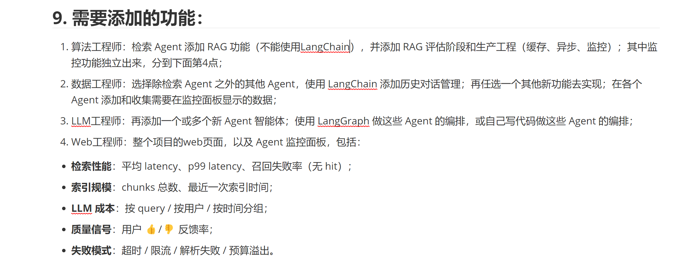

# 四类工程师任务与答辩文档

更新日期：2026-11-02（北京时间）。适用项目：医疗问诊多智能体协作系统。

本套文档严格按原照片中的四类岗位划分。它是当前项目的职责说明与交付安排，不是对个人历史提交量的认定，也不把已有缺项写成已完成验收。

## 分别阅读

1. [算法工程师：原生 RAG、评估、缓存与索引任务](01_算法工程师.md)
2. [数据工程师：LangChain 历史、信息核对卡与监控采集](02_数据工程师.md)
3. [LLM 工程师：新增 Agent、模型接口与自写编排](03_LLM工程师.md)
4. [Web 工程师：全站交互、核对卡表单与监控面板](04_Web工程师.md)
5. [问诊信息核对卡：实现、演示与测试记录](05_问诊信息核对卡验收.md)

## 尽量不重叠的归属

| 工作单元 | 主负责人 | 接收其成果的人 |
| --- | --- | --- |
| 向量编码、Milvus、BM25/RRF、切片、检索缓存、RAG 评估计算 | 算法 | LLM 调用检索接口；Web 展示证据与评估结果 |
| 非检索 Agent 的 LangChain 历史、SQLite 对话与核对卡业务规则 | 数据 | LLM 接收历史与用户确认信息；Web 调用保存接口 |
| 各 Agent 埋点、事件字段、身份绑定、用量/反馈采集 | 数据 | Web 按约定字段统计并展示 |
| 视觉观察/复核/重排 Agent、提示词、输出校验、主备 API 与编排控制流 | LLM | 算法提供检索；数据提供历史、药品证据与采集接口 |
| 登录、导航、问诊/历史/用药/家庭表单、结果渲染、监控聚合与展示 | Web | 使用前三类已实现的业务接口 |
| 新核对卡的提取、合并、冲突、来源、去重、摘要模板 | 数据 | Web 只负责编辑和下载交互；不重复实现规则 |
| 新核对卡的六字段表单、状态提示、版本/来源查看 | Web | 数据提供存储与业务模块 |
| 核对卡与协作链共用 request_id | LLM 负责协调器参数；数据定义来源契约 | Web 在页面提交处传入同一编号 |

## 共享文件按代码块交接

- `agents/coordinator.py`：数据负责问诊历史/上下文契约与 `record(...)` 埋点；LLM 负责 `Coordinator.run()` 调度、模型调用和进度回调。算法只维护被调用的检索服务，不改调度。
- `agents/llm.py`：LLM 负责网络协议、重试、预算执行和输出校验；数据负责用量/失败事件字段与成本口径；Web 只展示汇总。
- `app_pages/agent_consultation.py`：Web 维护页面、表单与业务 API 调用位置；规则放在数据负责的独立模块，页面中不再写第二套提取逻辑。
- `ui.py`：算法维护 `retrieval()/document_jobs()` 资源工厂；LLM 维护配置映射；Web 维护 `evidence_cards()` 展示。

“监控独立出来”在这里指独立的采集接口与监控页面：**数据工程师采集，Web 工程师呈现**。算法文档只讲检索返回指标，不包办监控页面。

## 阅读与截图说明

各文档末尾列出绝对源码位置、函数/代码区域和本次行号。行号随后续编辑可能变化，以函数名定位为准。截图文件随 Markdown 一起提供，移动时保留 `images` 文件夹。

除原始要求图外，截图均为本次实际页面截图。使用隔离演示运行目录、正常登录的“答辩演示”账号；核对卡示例来自用户给定验收文本。没有启用模型 API，没有伪造模型输出。截图中的 8510 是临时取证端口，日常使用仍打开本机 8502。

本次新增核对卡专项 9 项测试，连同对话/API/编排/风险/视觉/用药共 73 项回归通过。另通过历史与私信页面流程检查、10 个页面三轮切换检查。真实模型服务、费用配置与全部临床能力不属于本次离线测试通过结论。

课程旧缺项保留在上一层 `课程第9项功能核查.md`：当前混合检索与旧向量评估口径不同、成本配置与失败计费不完整、统一预算拦截埋点仍有缺口、公网管理入口未完成。核对卡完成不会自动消除这些缺项。
